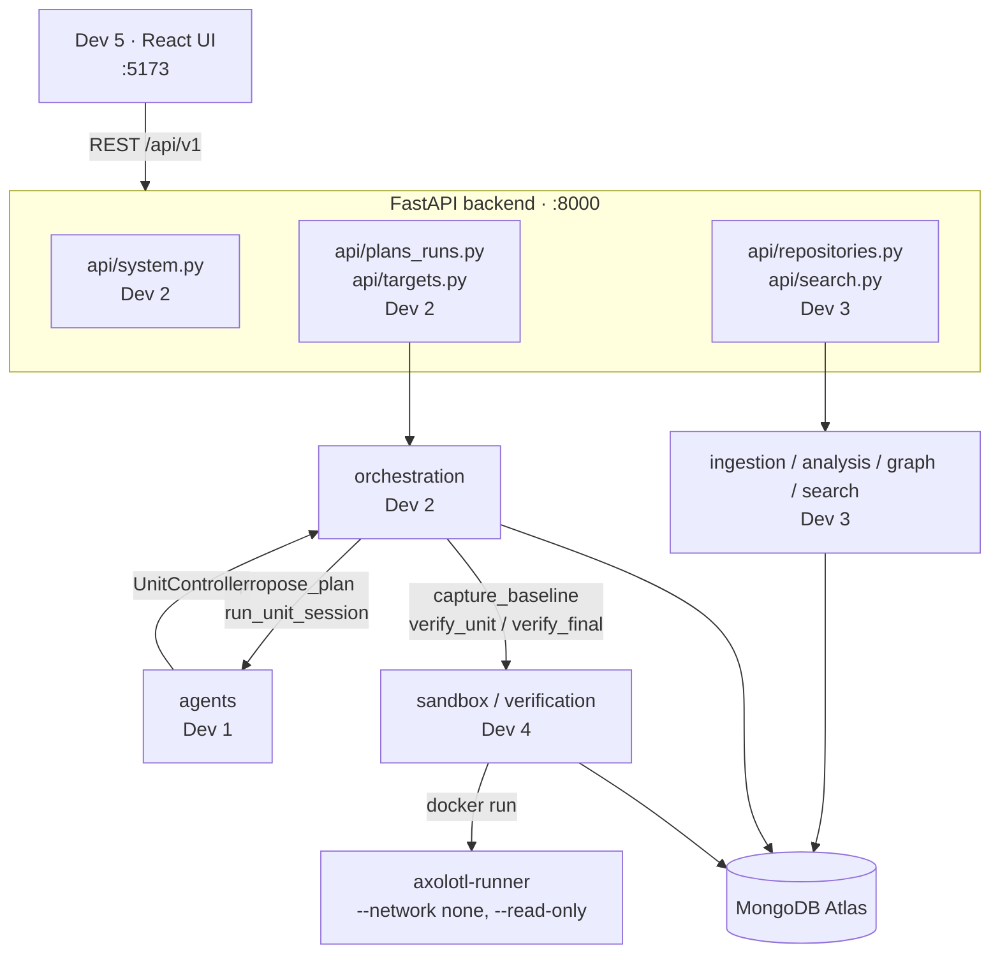

# Architecture

Owner: Dev 2. Companion to [`planning/SHARED_CONTRACTS.md`](planning/SHARED_CONTRACTS.md)
(names, shapes, ownership) and the Spec (product and safety rules).

---

## 1. The idea in one paragraph

A legacy Python project is imported and parsed into a real dependency graph. The graph
is collapsed into **migration units** and walked dependency-first. For each unit, a
Gemini agent proposes a patch; the patch is applied to a throwaway workspace; then an
**independent verifier** runs the original and the candidate against the same recorded
behaviour cases in a sandbox and compares their outputs. A unit advances only when its
required gates pass. The agent never decides whether it succeeded.

## 2. The one rule everything else follows

```
Dev 4's verifier decides pass/fail  ->  Dev 2 records it  ->  Dev 5 displays it
```

Dev 1's model only ever *proposes*. Concretely, in code:

- `UnitControllerImpl.is_verified()` reads the latest **persisted** `VerificationResult`
  and nothing else. No flag, no model claim, no agent return value sets it.
- `UnitControllerImpl.emit()` accepts only `agent_turn`, `agent_tool_call` and
  `agent_tool_result`. The model physically cannot write a `verification_passed` event.
- `final_verdict()` returns `completed` only when every unit passed **and** the final
  gates passed. Inconclusive is not a pass.

If you are about to add a code path where something other than a recorded
`VerificationResult` makes a unit `passed`, stop — that is the one thing this project
is about.

## 3. Shape



Backend on `:8000`, frontend on `:5173`, CORS restricted to `FRONTEND_ORIGIN`.

## 4. Packages and owners

| Path | Owner | What lives there |
|---|---|---|
| `app/main.py`, `config.py`, `errors.py` | Dev 2 | app factory, settings, error envelope |
| `app/models/contracts.py` | Dev 2 | SHARED_CONTRACTS §4 — **everyone imports this** |
| `app/api/repositories.py`, `search.py` | Dev 3 | import, graph, module/symbol, search |
| `app/api/plans_runs.py`, `targets.py`, `system.py` | Dev 2 | plans, runs, events, report, status |
| `app/persistence/`, `ingestion/`, `analysis/`, `graph/`, `search/` | Dev 3 | Atlas, AST, graph, hybrid search |
| `app/agents/` | Dev 1 | model adapter, tool schemas, prompts, agent loop |
| `app/orchestration/` | Dev 2 | scheduler, state machine, events, controller, worker |
| `app/reports/` | Dev 2 | run report assembly |
| `app/sandbox/`, `verification/` | Dev 4 | workspaces, patches, Docker runner, differential verifier |
| `runner/` | Dev 4 | sandbox image, harness, policy |
| `demo/` | Dev 4 | legacy fixture, visible and held-out cases |
| `frontend/` | Dev 5 | everything UI |

## 5. The main journey

```
POST /repositories/import          Dev 3   fixture -> snapshot -> AST -> Atlas
GET  /repositories/{id}/graph      Dev 3   real module graph
POST /repositories/{id}/plans      Dev 2   build_units -> Argon orders -> validate
POST /plans/{id}/approve           Dev 2   a human approves; runs need this
POST /plans/{id}/runs              Dev 2   run created, background task starts
        state baselining           Dev 4   capture_baseline on the immutable snapshot
        for each eligible unit:
            unit -> migrating      Dev 2
            run_unit_session       Dev 1   model proposes patches via UnitController
                submit_patch       Dev 2   fresh workspace, allowlist = unit.file_paths
                run_verification   Dev 4   compile / differential / impacted / tests
            passed or blocked      Dev 2   from the persisted VerificationResult only
        state final_verification   Dev 4   always runs (T-14)
        verdict + report           Dev 2
GET  /runs/{id}/events             Dev 2   the frontend polls this every 1.5 s
```

## 6. Scheduling

`orchestration/scheduler.py` is sync and pure — no I/O, no database, no model. That is
deliberate: it is the part that must be obviously correct, so it is exhaustively unit
tested without any infrastructure.

- Edge direction is **A → B means A depends on B** (A imports B). Get this backwards
  and the whole order inverts.
- `nx.condensation` collapses strongly connected components. A multi-module cycle
  becomes **one unit** with `is_cycle=True`, because its members cannot be migrated
  independently.
- `eligible_units` releases a unit only when it is `queued` and every dependency is
  `passed`.
- `units_to_skip` is **T-13**: anything transitively downstream of a `blocked` unit is
  `skipped` with a reason. Nothing is ever migrated through a failed prerequisite.
- `impacted_units` gives the transitive reverse dependants whose cases must rerun.
- Argon may reorder *within* eligibility. If its `suggested_order` is not a valid
  topological order of the condensation it is discarded, and the reason is recorded in
  the plan's `rationale`.

## 7. State machine

`orchestration/states.py`. Every change goes through `transition_run` or
`transition_unit`, which raise on an illegal move rather than letting a run drift.

```
run    queued -> baselining -> migrating -> verifying -> final_verification
                                   ^            |
                                   +- repairing +
       -> completed | completed_with_warnings | failed | cancelled

unit   not_planned -> queued -> migrating -> verifying -> passed
                        |           ^           |
                        |           +-repairing-+
                        +-> skipped             +-> blocked
```

A run cannot reach `completed` except through `final_verification` with the gates
actually green. A unit cannot reach `passed` except out of `verifying`.

> **Known conflict, needs a §11 ack.** Spec §6.2's diagram contains `parsing`,
> `planning` and `awaiting_approval`, which `RunState` in §4 does not have, and `RunState`
> has `cancelled`, into which §6.2 never transitions. SHARED_CONTRACTS §0 says it wins on
> names and shapes, so the tables are built over the enums. The reasoning is in
> `states.py`'s module docstring. **Please ack or correct this.**

## 8. The event journal

`run_events` is append-only and written **only** through `events.append_event`. Sequence
numbers come from an atomic `$inc` on `counters`, so concurrent writers never collide,
and the frontend can poll `?after_sequence=N` without missing or repeating anything
(T-15). Every payload is redacted of env secret values and truncated to 2 KB.

Redaction runs **before** truncation. The other order would cut a secret in half and
leave its first 2 KB in the journal.

## 9. Safety properties and where they are enforced

| Property | Enforced in |
|---|---|
| Model cannot exceed its patch budget | `controller.submit_patch` — a fourth patch never reaches the sandbox |
| Patch cannot touch another unit's files | `controller.submit_patch` passes `unit.file_paths` as the allowlist; Dev 4 enforces |
| Model cannot fake a verification | `controller.emit` rejects anything outside the three `agent_*` types |
| Model cannot read held-out cases | API layer: `include_held_out=False` and redaction; exposure releases exactly one case |
| Baseline is never written to | all container mounts are `:ro`; T-09 asserts the tree hash is unchanged |
| Uploaded code never executes | `executable=False` for ZIPs; 409 `REPOSITORY_NOT_EXECUTABLE` |
| No silent degradation | no in-memory fallback anywhere; Atlas down is 503 `DATABASE_UNAVAILABLE` |
| Interrupted runs don't lie | startup marks non-terminal runs `failed`, `error="interrupted by server restart"` |

## 10. Integration points

`orchestration/ports.py` declares the three things the orchestrator does not own and
resolves them **lazily on every call**, so each owner's real function is picked up the
moment it exists, with no edit to `ports.py`.

Until then a call raises `IntegrationUnavailable`, which the worker turns into an honest
inconclusive or blocked outcome — never a pass. Nothing in that file invents a graph, a
patch or a verdict.

## 11. What is real today

| Area | State |
|---|---|
| App boots, `/health`, `/system/status` | **real** — status does a live Mongo `ping` and `listSearchIndexes` |
| Gemini reachability check | **real** — reports unreachable with no key; `models.get` with one |
| Contracts, config, error envelope | **real** |
| Scheduler, state machine, events, plans, controller, worker, reports, artefacts | **real**, 177 tests |
| Graph status overlay (`get_unit_statuses`) for Dev 3 | **real** |
| Live Atlas and Gemini checks behind the `live` marker | **real**, skip without `.env` |
| All 15 of Dev 2's §6 endpoints | **registered**; the ones needing Atlas return 503 until `.env` exists |
| Demo fixture + sandbox runner | **real and proven in a container** |
| Frontend | status chips only — the 8 screens are Dev 5's work |
| Import, AST, graph, search | **not started** (Dev 3) |
| Workspaces, patches, differential verifier | **not started** (Dev 4) |
| Agent adapter, prompts, tools | **not started** (Dev 1) |

The only stub in the repo is `sandbox._runner_status_stub`. `grep -r _stub backend/`
must come back empty before the Saturday 17:00 dry run.
